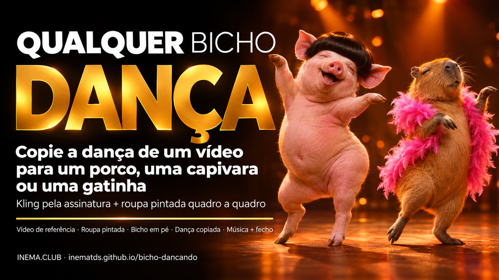
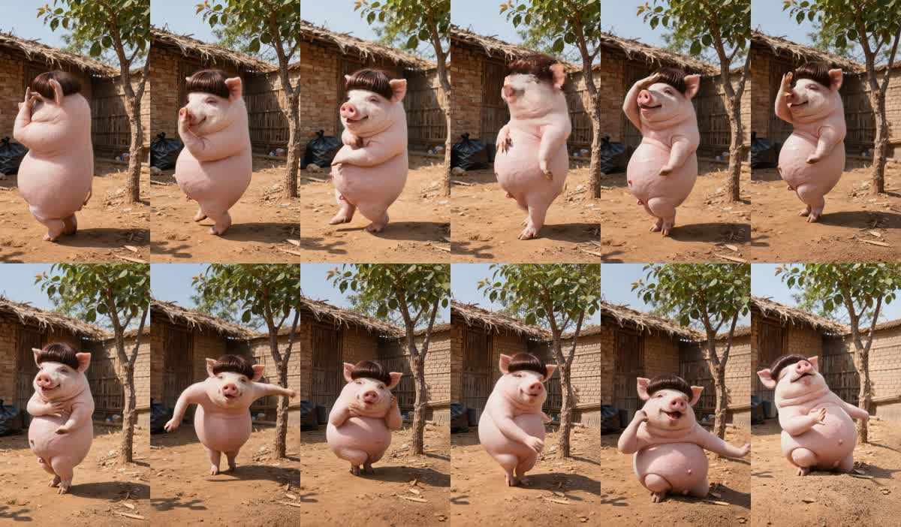
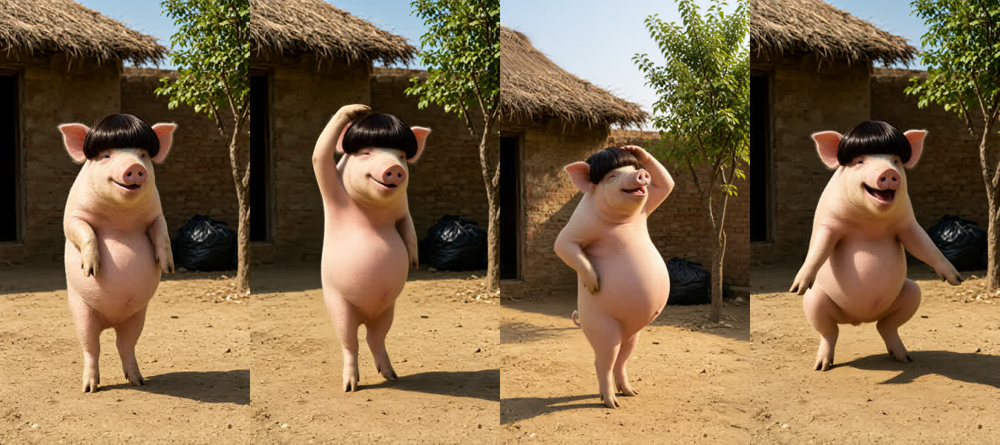

# bicho-dancando

[](https://inematds.github.io/bicho-dancando/guia/)

**🇧🇷 [Português](README.md) · 🇺🇸 [English](README.en.md) · 🇪🇸 [Español](README.es.md)**

## O que é

O bicho-dancando é um kit de scripts para quem faz vídeos curtos e quer um bicho dançando igualzinho a um vídeo de referência. Você dá um vídeo de alguém dançando e uma frase descrevendo o bicho; o kit pinta uma roupa no dançarino, cria a imagem do bicho em pé e manda o Kling (gerador de vídeo por IA) copiar os passos. No fim junta a música e um fecho com o texto do INEMA.CLUB. Precisa de uma assinatura do Kling com a ferramenta de linha de comando instalada, Python e ffmpeg.

## 📖 Guia de uso

Guia completo (landing + passo a passo): **https://inematds.github.io/bicho-dancando/guia/**

Kit para pegar a dança de um vídeo e fazer **qualquer bicho** dançar igual: porco, capivara, gatinha.
Usa o Kling pela assinatura (CLI `kling`) e, como alternativa grátis, o Agnes. Os scripts locais
(pose, roupa pintada, fecho) rodam na sua máquina, sem custo.

| Versão | Como | Fidelidade aos passos | Custo medido (24 s, 720p) |
|---|---|---|---|
| **Dança copiada** (recomendada) | referência "vestida" + Kling Motion Control 3.0 | quase quadro a quadro | 216 créditos |
| Kling 4.0 por texto | imagem do bicho + coreografia descrita no prompt | passos livres | 240 créditos |
| Agnes | 4 poses + 3 clipes keyframe de 8 s | passos livres, pode desviar de cena | grátis (API Agnes) |



## Exemplos em vídeo

Os três bichos dançando a mesma dança (216 créditos cada):

- 🐷 Porco de cabelo de cuia — https://www.youtube.com/watch?v=3jfNlJ4DduI
- 🦫 Capivara diva — https://www.youtube.com/watch?v=opnakJZBDro
- 🐱 Gatinha fofa — https://www.youtube.com/watch?v=aivt5jwgGX4

## O processo, do início ao fim

Legenda: 🧠 sessão com o Nei · ⚙️ script · 🤖 serviço de IA

1. 🧠 **Escolher o vídeo de referência** (um dançarino de corpo inteiro, câmera parada). Baixar com o inemavox:
   `python3 baixar_v1.py --url "<URL>" --outdir ref/`
2. ⚙️ **Vestir o dançarino** — `python3 kit/vestir.py ref/video.mp4 vestida.mp4`. O MediaPipe acha a pose e a
   silhueta de cada quadro e pinta camiseta e short. Por quê: o Kling **recusa** vídeo de corpo que parece nu
   (`AGENT.FileCensorshipUnsafe`), e um **boneco de traços** (`kit/boneco.py`) passa na checagem mas falha com
   "No valid characters detected". Roupa pintada passa nas duas.
3. 🤖 **Criar o bicho** em pé, 9:16 — `kling text_to_image --model kling-image-v3_0_omni --aspect_ratio 9:16 ...`
   (4 créditos por 2 imagens). Escolher a que mostra o corpo inteiro com espaço em volta.
4. 🤖 **Copiar a dança** — `kling motion_control --model kling-video-v3_0 --image bicho.png --video vestida.mp4
   --motionDirection motion_direction --resolution 720p`. No prompt, pedir "natural fur, no clothes" para a roupa
   da referência não passar para o bicho.
5. ⚙️ **Música + fecho** — juntar o áudio da referência e rodar `python3 kit/fecho.py danca.mp4 final.mp4`:
   nos últimos 4,5 s o vídeo escurece e o texto se escreve letra a letra
   ("construindo no / **INEMA.CLUB** / baixa o kit", Montserrat Black, amarelo `#FACC15`).
6. 🧠 **Conferir a folha de quadros** antes de publicar (rosto, fundo, mãos).
7. ⚙️ **Publicar** — YouTube pelo `yt-pubx --agendar` (um por hora) e Instagram/TikTok pelo Metricool.

Tudo de uma vez (passos 2–5):

```bash
kit/dancar.sh ref/video.mp4 capivara "chubby capybara diva with a pink feather boa and red lipstick"
```

## Versão grátis com o Agnes

`kit/agnes_poses.py` (exemplo do porco): 1 imagem-âncora + 3 poses derivadas dela (img2img, para ser o mesmo
bicho) + 3 clipes keyframe de 8 s indo de pose a pose em 9:16. Precisa do projeto `videos-agnes` e de
`AGNES_API_KEY`. Limite medido: num dos 3 clipes a cena desviou (fundo trocado, bicho de costas) — conferir a
folha e refazer só o clipe torto.



## Arquivos

| Arquivo | O que faz |
|---|---|
| `kit/dancar.sh` | passos 2–5 numa chamada |
| `kit/vestir.py` | pinta roupa no dançarino da referência (pose + máscara MediaPipe) |
| `kit/boneco.py` | desenha um manequim de traços com a mesma dança (bom para estudar a coreografia) |
| `kit/fecho.py` | escurece o fim e escreve o texto do INEMA.CLUB letra a letra |
| `kit/agnes_poses.py` | versão Agnes: poses + clipes keyframe |

Requisitos: `ffmpeg`, Python 3 com `mediapipe`, `opencv-python`, `pillow`; CLI `kling` logada
(`npm i -g @klingai/cli-global` + `kling login`). O modelo de pose (30 MB) baixa sozinho na 1ª vez. O fecho usa `~/.local/share/fonts/Montserrat-Black.ttf` (Google Fonts, pasta `static/` do zip).

## Limites

- O Kling decide o que é "personagem": traço puro não conta; bicho fotorrealista em pé conta.
- Pose do bicho importa: com a capivara "parada" (patas junto ao corpo) o Motion Control devolveu "No valid characters detected in the image" (sem cobrança); a mesma capivara em pose de dança (perna levantada, braços afastados) funcionou. Escolha a imagem com braços e pernas bem separados do corpo.
- Motion Control herda o enquadramento da referência; se o dançarino sai do quadro, o bicho também sai.
- Login da CLI vence: `kling login` abre o navegador e espera só 5 minutos pelo retorno.
